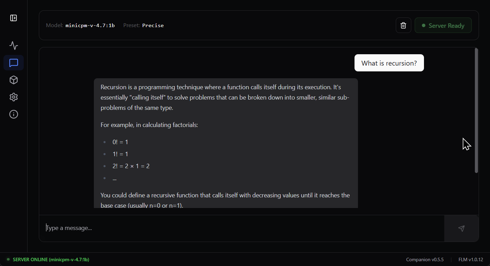
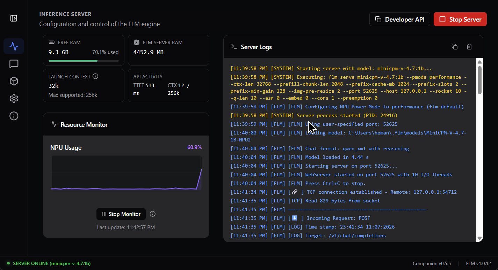
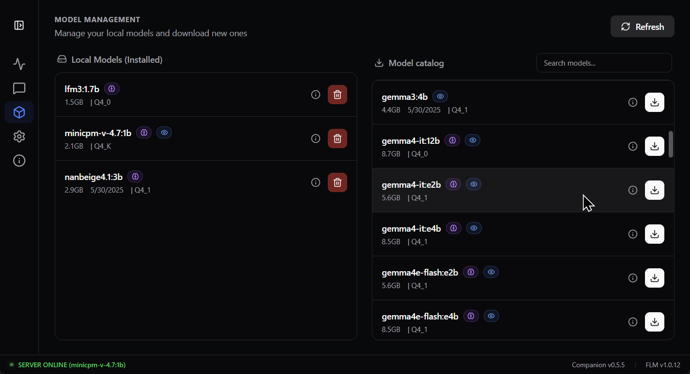
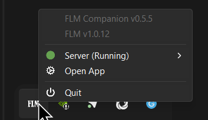

# FLM Companion

Windows desktop companion for [FastFlowLM](https://github.com/FastFlowLM/FastFlowLM).

This fork turns FLM into a practical local model workstation: launch models, manage servers, monitor hardware, chat through an OpenAI-compatible endpoint, and keep server state visible from the system tray.

[](https://github.com/plushycat/Flm-Companion/releases)
[](https://github.com/plushycat/Flm-Companion/actions/workflows/main.yml)
[](LICENSE)

## What this fork adds

- Server-first dashboard for starting and stopping FLM.
- Chat connected to the active server.
- Companion-owned API proxy at `127.0.0.1:52626` that exposes only the active model through `/v1/models`.
- Accurate installed/download model sizes.
- Live RAM, FLM process RAM, NPU usage, launch context, and TTFT visibility.
- System-tray controls for server state, installed model selection, presets, logs, and features.
- FLM process cleanup on stop, restart, application quit, and server failure.
- Persistent selected model and launch settings.
- Startup checks and update flows for Companion and FLM.
- English, French, and Japanese UI.
- Optional Caveman mode for short, dense chat replies.

## Requirements
- Windows.
- [FastFlowLM](https://github.com/FastFlowLM/FastFlowLM) `0.9.37` or newer.
- Current AMD NPU driver supported by FLM.

FLM remains separate software. Install it from its [upstream releases](https://github.com/FastFlowLM/FastFlowLM/releases), then launch Companion.

## Install

Download the latest Windows installer from the [Companion releases page](https://github.com/plushycat/Flm-Companion/releases).

After installation:

1. Install FastFlowLM if needed.
2. Open FLM Companion.
3. Select an installed model.
4. Configure launch options or choose a preset.
5. Start the server.
6. Use Chat or connect a client to the local API.

Default ports:

| Service | Port |
| --- | ---: |
| FastFlowLM server | `52625` |
| Companion API proxy | `52626` |

## Development

Prerequisites:

- Node.js.
- Rust stable for Windows GNU.
- FastFlowLM installed locally for runtime testing.

Install dependencies:

```powershell
Push-Location src
npm install
Pop-Location
```

Run the native Tauri app:

```powershell
npm --prefix src run tauri dev
```

Run checks:

```powershell
Push-Location src
npm run lint
npm run build
Pop-Location

cargo check --manifest-path src\src-tauri\Cargo.toml
```

Build release artifacts:

```powershell
npm --prefix src run tauri build
```

The installer is generated under `src/src-tauri/target/release/bundle/`.

## Project layout

```text
src/src/          React, TypeScript, services, hooks, and views
src/src-tauri/    Tauri shell, tray, process cleanup, system metrics, API proxy
changelog/        Release notes
screen/            UI and tray demos
```

Frontend state flows through `AppContext`. FLM process and model operations live in `src/src/services/flm.ts`. Native tray and API-proxy behavior lives in `src/src-tauri/src/`.

## Screens









## Links

- [Companion source](https://github.com/plushycat/Flm-Companion)
- [Companion releases](https://github.com/plushycat/Flm-Companion/releases)
- [FastFlowLM upstream](https://github.com/FastFlowLM/FastFlowLM)
- [FastFlowLM releases](https://github.com/FastFlowLM/FastFlowLM/releases)

## License

See [LICENSE](LICENSE).
